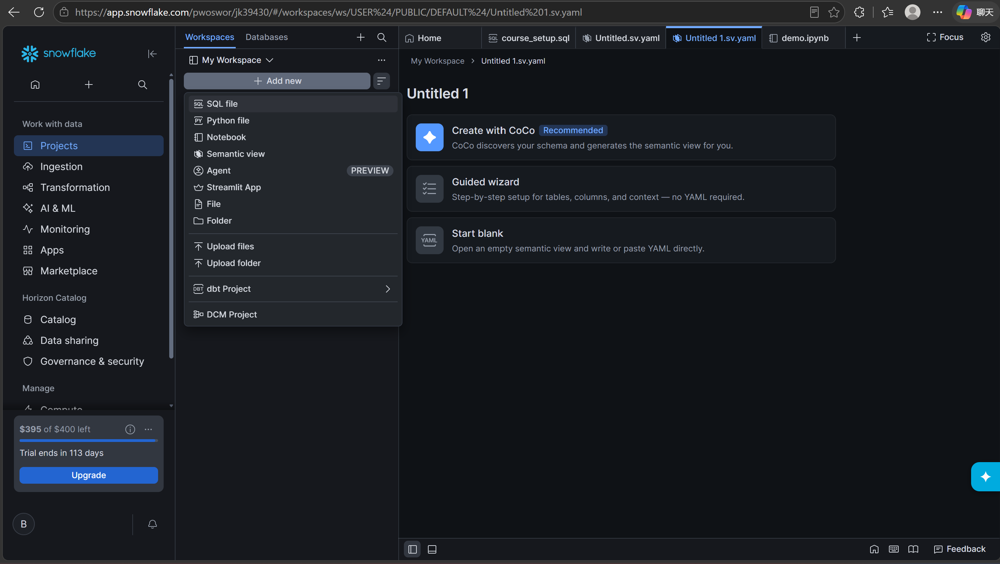

# 2026.10.12

## LoRA Fine tuning Deepseek model

Step1(Projects →+Add new →SQL File)

Step2(rename SQL name → input codes → run)

DS_LORA_GPU_POOL successfully created  means it can use GPU.

Step3 configue and import open source model(AI&ML → Models → Import model)

Step4 search liked model

Do not select enable trust remote code

Step 5 config imported model

Step6 deploy model

Step7 upload dataset(Add new → Upload files)

dataset file Link:[databricks-dolly-15k.jsonl · databricks/databricks-dolly-15k at main](https://huggingface.co/datasets/databricks/databricks-dolly-15k/blob/main/databricks-dolly-15k.jsonl)

Step8 check the V2 model has existed in model registry,we can see the files list(Add code:

`SHOW MODELS IN SCHEMA LORA_DEMO.DOLLY;
LIST 'snow://model/LORA_DEMO.DOLLY.DEEPSEEK_R1_DISTILL_LLAMA_8B/versions/V2/';`

)

Step9 add a notebook file to check the weight and the different before and after fine tuned model

---